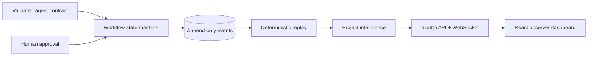

# AI Vault Showcase

AI Vault Showcase is a local, educational demonstration of event-driven software workflows, human approval gates, deterministic replay, and observable project state. It combines a Python `aiohttp` API with a React dashboard and one intentionally synthetic demo project.

The repository models AI-agent engineering boundaries: it validates structured agent-response contracts and requires explicit approval before a proposed patch can advance. **It does not bundle an autonomous LLM provider, call a model API, or execute generated code.**

## What it demonstrates

- append-only, validated workflow events with logical clocks
- structured planner/executor/reviewer contracts
- goals and iteration state transitions
- explicit approval, patch preview, application, and verification gates
- deterministic replay and project-intelligence projections
- read-only HTTP and WebSocket observer surfaces
- a React dashboard for workflow status
- synthetic fixtures, automated tests, and privacy-oriented release checks

## Architecture



See [Architecture](docs/ARCHITECTURE.md), [Event model](docs/EVENT_MODEL.md), and [Security and privacy](docs/SECURITY_AND_PRIVACY.md).

## Requirements

- Python 3.12
- Node.js 20+

## Reproducible local setup

```bash
python3.12 -m venv .venv
.venv/bin/pip install --upgrade pip
.venv/bin/pip install -e '.[dev]'
.venv/bin/python -m aivault_showcase.cli seed-demo
.venv/bin/python -m aivault_showcase.cli status
```

Start the observer API:

```bash
.venv/bin/python -m aivault_showcase.cli serve
```

In another terminal, start the dashboard:

```bash
cd observer_dashboard
npm ci
npm run dev
```

Open `http://127.0.0.1:5173`. Runtime events are created under ignored `.runtime/`; no generated event log is committed.

## Validation

```bash
.venv/bin/ruff check .
.venv/bin/pytest
cd observer_dashboard && npm ci && npm test && npm run build
scripts/scan_repository.sh
```

## Project status and limitations

This is a source-code showcase for local use, not a production service. It has one synthetic workflow, no user accounts, no distributed event broker, no model-provider integration, and no remote patch executor. The dashboard is read-only. See [Limitations](docs/LIMITATIONS.md).

## Data and licensing

All bundled demo material is synthetic and was written for this showcase. No private project events, prompts, transcripts, memory, operational state, or user data are included. Dependencies retain their own licenses. This repository currently has **no project license**, so no permission to copy, modify, or redistribute the project code is granted by default.

