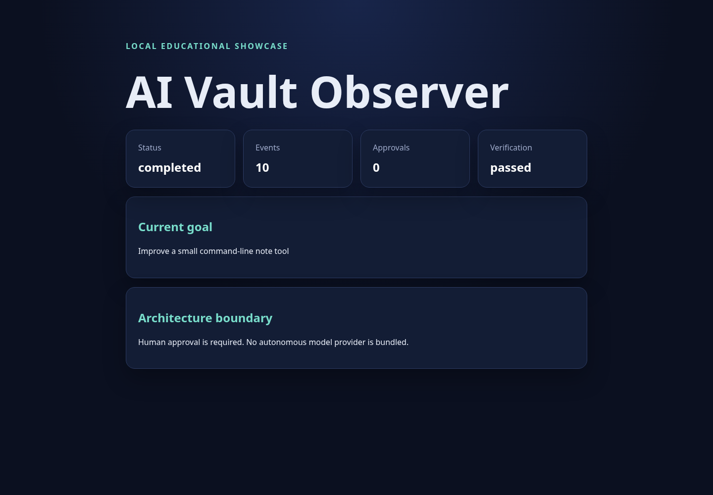
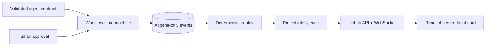

# AI Vault Showcase

AI-assisted workflows become difficult to trust when decisions, approvals, and state changes disappear inside an opaque execution loop. AI Vault Showcase explores a different approach: every workflow transition is represented as a validated event, risky progress requires explicit human approval, and current state can be rebuilt deterministically.

The result is a local, educational architecture showcase combining a Python `aiohttp` API, an append-only event model, and a React observer dashboard. One intentionally synthetic project makes the complete workflow inspectable without exposing operational data.

The repository models AI-agent engineering boundaries: it validates structured agent-response contracts and requires explicit approval before a proposed patch can advance. **It does not bundle an autonomous LLM provider, call a model API, or execute generated code.**



## Why this project matters

This project focuses on the engineering around an AI agent rather than model-provider integration: contracts, approval boundaries, replayability, observability, and safe failure modes. It demonstrates how an agent-oriented system can remain understandable to both developers and reviewers.

## What it demonstrates

- append-only, validated workflow events with logical clocks
- structured planner/executor/reviewer contracts
- goals and iteration state transitions
- explicit approval, patch preview, application, and verification gates
- deterministic replay and project-intelligence projections
- read-only HTTP and WebSocket observer surfaces
- a React dashboard for workflow status
- synthetic fixtures, automated tests, and privacy-oriented release checks

## Architecture



See [Architecture](docs/ARCHITECTURE.md), [Event model](docs/EVENT_MODEL.md), and [Security and privacy](docs/SECURITY_AND_PRIVACY.md).

### Key engineering decisions

- **Events are the source of truth:** projections are derived rather than edited independently.
- **Approval is a separate event:** receiving a valid agent response never grants authority to apply it.
- **Replay is deterministic:** identical ordered events produce an identical state hash.
- **Observation is read-only:** the HTTP/WebSocket surface cannot advance workflow state.
- **The demo boundary is explicit:** there is no hidden model call, shell execution, or private project dependency.

## Requirements

- Python 3.12
- Node.js 20+

## Reproducible local setup

```bash
python3.12 -m venv .venv
.venv/bin/pip install --upgrade pip
.venv/bin/pip install -e '.[dev]'
.venv/bin/python -m aivault_showcase.cli seed-demo
.venv/bin/python -m aivault_showcase.cli status
```

Start the observer API:

```bash
.venv/bin/python -m aivault_showcase.cli serve
```

In another terminal, start the dashboard:

```bash
cd observer_dashboard
npm ci
npm run dev
```

Open `http://127.0.0.1:5173`. Runtime events are created under ignored `.runtime/`; no generated event log is committed.

## Validation

```bash
.venv/bin/ruff check .
.venv/bin/pytest
cd observer_dashboard && npm ci && npm test && npm run build
scripts/scan_repository.sh
```

GitHub Actions repeats backend lint/tests, dashboard tests/build, and generic secret scanning on pushes and pull requests. The synthetic workflow is covered from event creation through replay and observer responses.

## Project status and limitations

This is a source-code showcase for local use, not a production service. It has one synthetic workflow, no user accounts, no distributed event broker, no model-provider integration, and no remote patch executor. The dashboard is read-only. See [Limitations](docs/LIMITATIONS.md).

## Data and licensing

All bundled demo material is synthetic and was written for this showcase. No private project events, prompts, transcripts, memory, operational state, or user data are included. Dependencies retain their own licenses. This repository currently has **no project license**, so no permission to copy, modify, or redistribute the project code is granted by default.
