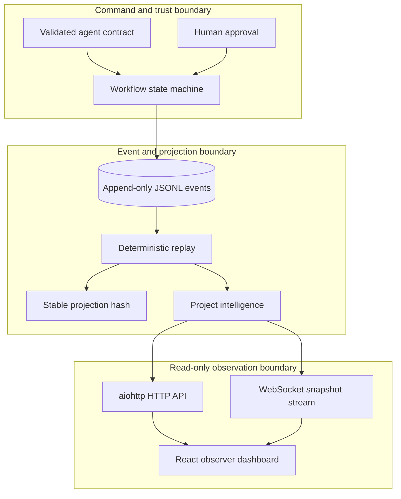
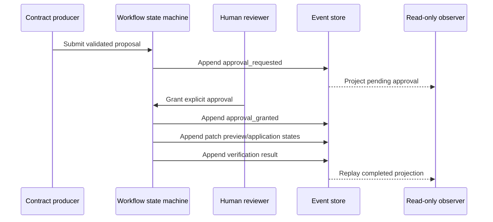

# Architecture

The showcase uses an event log as its source of truth. Commands validate inputs, append one immutable event at a time, and derive current state by replaying the ordered stream.

## Components

| Component | Responsibility |
|---|---|
| `models.py` | Immutable event and contract records |
| `events.py` | Identifier/event validation, append-only persistence, clock integrity |
| `contracts.py` | Strict agent-response schema and role validation |
| `workflow.py` | Goal, iteration, approval, patch, and verification transitions |
| `replay.py` | Deterministic state projection and stable projection hash |
| `intelligence.py` | Status, metrics, and timeline views |
| `api.py` | Read-only health, overview, event, and WebSocket interfaces |
| `observer_dashboard/` | React presentation of the read-only projection |

## Trust boundary

An external model could produce a contract, but no provider is included. Contract receipt is not authorization. The state machine requires a separate approval event before patch preview/application. In this showcase, “patch application” is a state transition only; it does not mutate application source or invoke shell commands.

## Storage

The CLI writes demo runtime events beneath `.runtime/`, which is ignored. Bundled `demo/` files are declarative, synthetic metadata rather than execution history.

## Failure model

- Invalid identifiers, contracts, or event ordering are rejected before append.
- A stale logical clock cannot overwrite newer state.
- Missing approval prevents the patch state from advancing.
- Observer failure does not mutate or corrupt the event stream.
- Replay exposes inconsistent history instead of silently repairing it.
